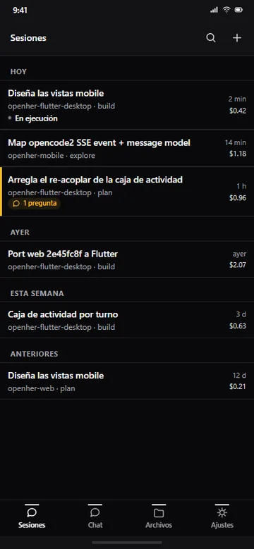
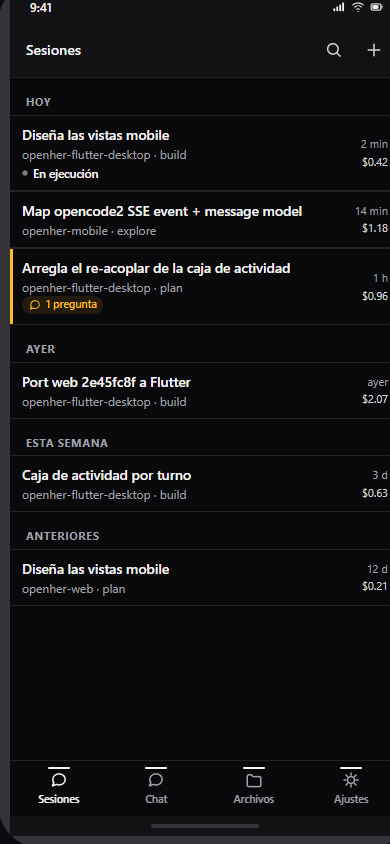
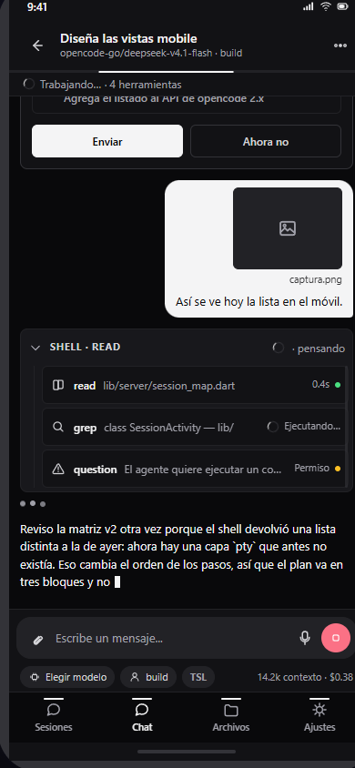
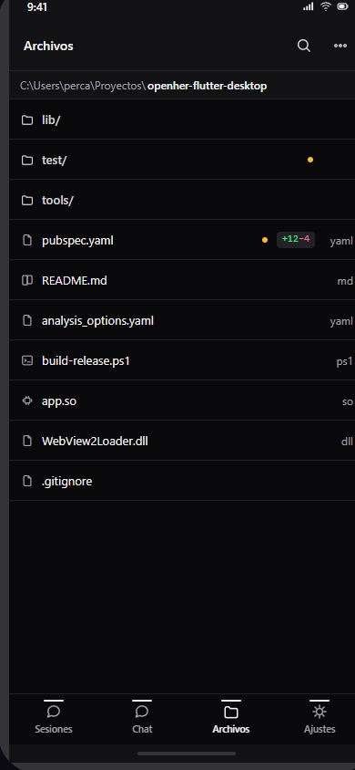
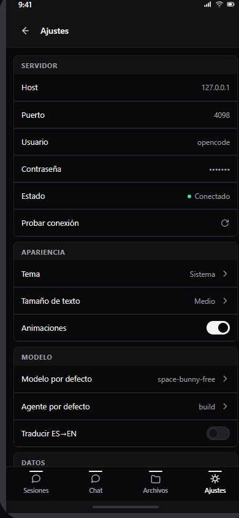

# OpenHer Mobile

<p align="center">
  
</p>

<p align="center">
  <strong>Cliente Android nativo y ultra-ligero para OpenCode</strong><br>
  <em>Tus sesiones, agentes, terminales y código en tu teléfono</em>
</p>

<p align="center">
  <a href="https://github.com/Owning01/openher-mobile/releases/latest">
    
  </a>
</p>

<p align="center">
  
  
  
</p>

---

> [!WARNING]
> ### 🚧 Estado del Proyecto: Versión Beta en Desarrollo
> **OpenHer Mobile se encuentra actualmente en fase Beta.** La aplicación recibe actualizaciones e incrementos continuos. Si experimentas algún comportamiento inesperado o quieres sugerir nuevas funciones, las contribuciones y reportes son bienvenidos.

---

## 📱 ¿Qué es OpenHer Mobile?

**OpenHer Mobile** es una aplicación diseñada específicamente para llevar el flujo de trabajo de **OpenCode** a tu bolsillo:

* **Conexión directa:** Habla en forma nativa con el servidor de OpenCode (dialecto v2 bajo `/api/*`) sin intermediarios ni proxies pesados.
* **Streaming en tiempo real:** Flujo reactivo vía SSE (Server-Sent Events) para visualizar las respuestas del asistente, estados de ejecución y herramientas (*tools*) a medida que operan.
* **Ergonomía móvil:** Navegación por gestos, pestañas inferiores accesibles con una mano, tema oscuro adaptado y rendimiento optimizado para bajo consumo de batería y datos móviles.
* **Credenciales seguras:** La autenticación se guarda localmente y cifrada con el almacén seguro de Android (`flutter_secure_storage`).

---

## 📸 Vistas Principales

| 💬 Sesiones | ⚡ Chat & Streaming | 📁 Archivos | ⚙️ Ajustes |
|:---:|:---:|:---:|:---:|
|  |  |  |  |
| Historial, estados activos y filtros | Ejecución de turnos, código y tools | Explorador de archivos del proyecto | Configuración de servidor y temas |

---

## 🌐 Cómo Conectar la App al Servidor OpenCode

Al abrir la aplicación por primera vez verás la pantalla de conexión. Para vincularla con tu computadora necesitas los datos con los que corre `opencode serve`.

### 1. Datos de conexión requeridos
* **Host / IP:** La dirección IP de tu máquina en la red local o tu IP de Tailscale (ver diagrama abajo).
* **Puerto:** Por defecto `4098` (o el puerto configurado en `opencode serve`).
* **Usuario:** Por defecto `opencode`.
* **Contraseña:** La contraseña configurada en tu servidor (variable `OPENCODE_SERVER_PASSWORD`).

---

### 2. Escenarios de Red: Local vs Fuera de Casa (Tailscale)

```
┌─────────────────────────────────────────────────────────────────────────────┐
│                       ESCENARIO A: MISMA RED WI-FI                          │
│                                                                             │
│    [ Computadora con OpenCode ] ◄────── Wi-Fi Local ──────► [ Celular ]     │
│             192.168.1.50                                      Host:         │
│             Puerto: 4098                                  192.168.1.50      │
│                                                            Puerto: 4098     │
└─────────────────────────────────────────────────────────────────────────────┘

┌─────────────────────────────────────────────────────────────────────────────┐
│                   ESCENARIO B: REDES DISTINTAS (TAILSCALE)                  │
│                                                                             │
│  [ Computadora en Casa / Oficina ]                      [ Celular en 4G/5G  │
│         Tailscale VPN                                   o en otra Wi-Fi ]   │
│         100.85.120.45:4098                                Tailscale VPN     │
│                 ▲                                               ▲           │
│                 └─────────── Túnel Seguro Mesh (VPN) ───────────┘           │
│                                                                             │
│                         En la app móvil ingresas:                           │
│                          Host: 100.85.120.45                                │
│                          Puerto: 4098                                       │
└─────────────────────────────────────────────────────────────────────────────┘
```

#### 💡 ¿Estás fuera de casa o usando datos móviles?
Si tu teléfono no está conectado a la misma red Wi-Fi que tu computadora:
1. Instala **[Tailscale](https://tailscale.com/)** tanto en tu computadora como en tu celular Android.
2. Inicia sesión con la misma cuenta en ambos dispositivos.
3. Copia la dirección **IP de Tailscale de tu PC** (suele comenzar en `100.x.y.z`).
4. En **OpenHer Mobile**, escribe esa IP en el campo **Host** y conecta. ¡Listo! Tendrás acceso cifrado punto a punto desde cualquier lugar del mundo sin abrir puertos en tu router.

---

## 📦 Descarga e Instalación

El archivo instalable (APK) más reciente para Android está disponible directamente en GitHub:

👉 **[Descargar último APK de OpenHer Mobile (Releases)](https://github.com/Owning01/openher-mobile/releases/latest)**

*(Descarga `app-release.apk` en tu dispositivo Android e instálalo permitiendo la instalación de orígenes desconocidos si tu navegador lo solicita).*
